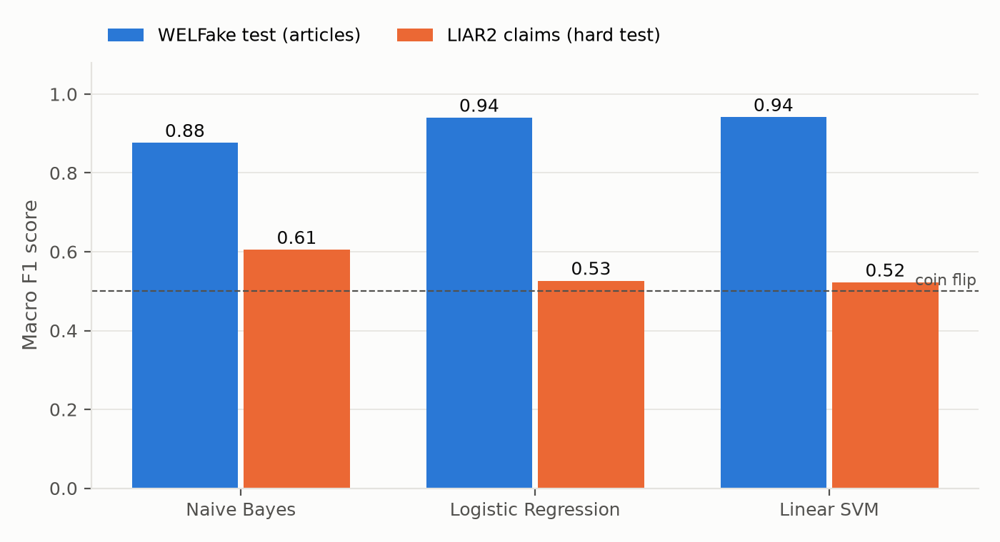
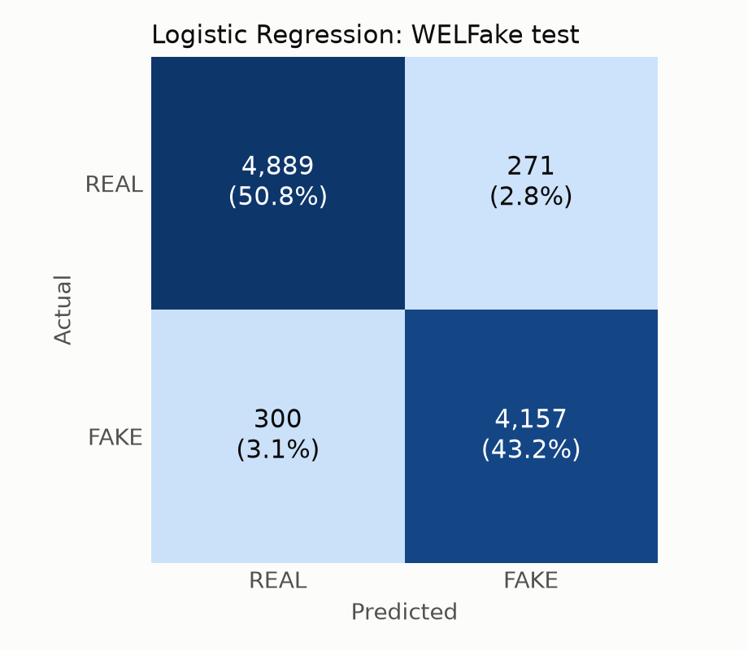
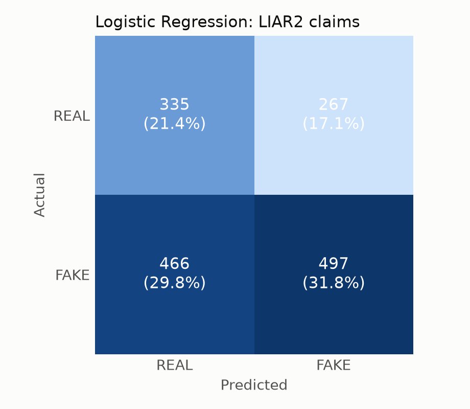
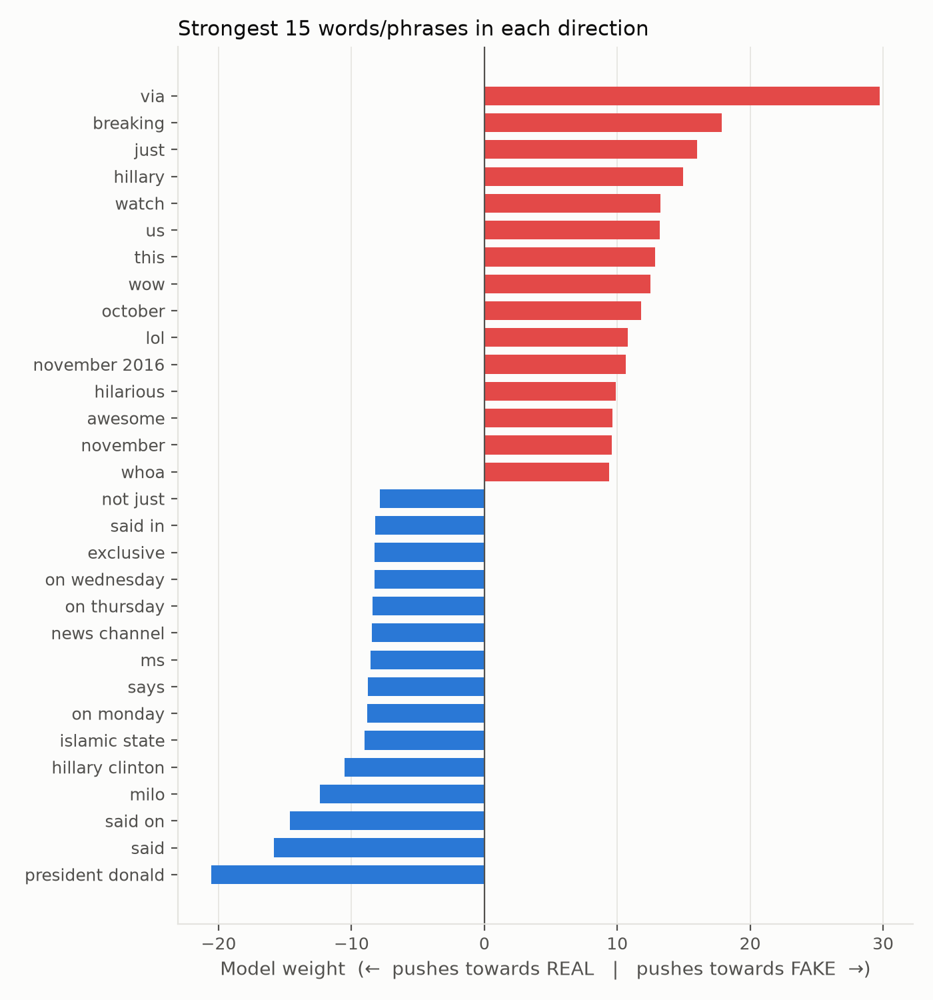

# TruthLens: Explainable Fake News Detection with Fact-Check Lookup

*Mini project report*

## Abstract

TruthLens is a web application that estimates whether an English news text is written like fake news, and shows exactly which words led to that estimate. It uses TF-IDF features and a Logistic Regression classifier trained on the WELFake dataset (63,580 articles after cleaning). Three classic models were compared (Naive Bayes, Logistic Regression, Linear SVM). On unseen WELFake articles the chosen model reaches 94.1% accuracy (macro F1 0.940). With an "uncertain" zone it answers 95.4% of articles and is right 95.9% of the time when it answers.

On a cross-dataset test of real PolitiFact claims (LIAR2), the same model reaches only 53.2%, which is below the 61.5% obtained by always answering "fake". This shows the main lesson of the project: a text classifier learns the *style* of its training sources, not the *truth* of a claim. The app therefore presents its output as a style-based signal, explains every decision word by word, and optionally searches published fact-checks through the Google Fact Check Tools API.

During development, the explanations exposed several "shortcut" features (source names and boilerplate that reveal the label). These were removed, and their effect on accuracy is reported.

## 1. Introduction

False news spreads quickly on social media, and readers rarely have time to verify what they share. Automatic detectors can help triage content, but two problems limit them:

1. **Black-box output.** A bare "fake, 97%" gives the reader no way to judge whether the reason makes sense.
2. **Over-optimistic accuracy.** Many published detectors score above 99% on benchmark datasets by learning which outlet wrote an article, not whether it is true.

TruthLens addresses both. It uses a model whose decision can be decomposed exactly into per-word contributions. It also deliberately measures where the model fails.

### Objectives

- Build a fake news classifier for English news text and compare classic machine learning models.
- Make every prediction explainable at the word level.
- Measure performance honestly: remove label-leaking artefacts, prevent train/test leakage, and test on a second, independent dataset.
- Deliver a secure web application that runs on a laptop and deploys to a free cloud host (Render).

### Scope

The project covers English text only. It does not analyse images or video, and it does not verify facts itself. Fact verification is delegated to published fact-checks, when available.

## 2. Datasets

| Dataset | Use | Size used | Labels |
|---|---|---|---|
| WELFake (Verma et al., 2021) | training, validation, test | 63,580 articles after cleaning (from 72,134) | fake / real |
| LIAR2 test split | cross-dataset test only | 1,565 claims | PolitiFact ratings, binarised |

**WELFake** merges four earlier collections (Kaggle, McIntire, Reuters, BuzzFeed Political). Each row has a title, article text and label.

**The label direction had to be checked.** The copy used states `1 = real` on its dataset card. However, 21,266 of the 21,282 articles containing "(Reuters)" carry label 0, and the paper reports 37,106 fake articles, which is exactly the count of label 1. This project therefore uses **1 = fake**. An independent reviewer reproduced this check.

**LIAR2** contains short political claims rated by PolitiFact on six levels (0 = pants-on-fire to 5 = true). Only the clear cases are kept: 0–1 become fake and 4–5 become real; the middle ratings are dropped.

## 3. Methodology

### 3.1 Pipeline

```
 headline + article
        │
        ▼
 clean_text()  ── normalise Unicode and quotes, remove source give-aways, URLs, @handles
        │
        ▼
 TF-IDF        ── single words and word pairs, 100,000 most useful terms,
        │          counts damped with 1 + log(count), weighted by rarity, scaled to length 1
        ▼
 Logistic Regression ── score = bias + Σ tfidf(term) × weight(term)
        │                P(fake) = 1 / (1 + e^(−score))
        ▼
 verdict: P ≥ 0.65 → Likely fake · P ≤ 0.35 → Likely real · otherwise Uncertain
 explanation: each term's tfidf × weight, shown as highlights
```

### 3.2 Cleaning and removal of label leaks

A model that recognises *who* published an article can score very highly without learning anything about misinformation. These artefacts were found partly by data analysis and partly from the model's own explanations, which listed outlet names among its strongest features. All of them were removed:

| Artefact | Appears mostly in | Example |
|---|---|---|
| Agency datelines | real | "WASHINGTON (Reuters) -" |
| Outlet names in titles | real | "… - The New York Times", "… - Breitbart" |
| Sponsor and correction notes | real | "independently created by the Reuters editorial staff", "(This story corrects …)" |
| Photo credits | fake | "Featured image via …", "Getty Images", "Image credit" |
| Site tags | fake | "21st Century Wire", "21WIRE", "Zero Hedge" |
| Embedded tweet residue | both, unevenly | "pic. twitter.", "(@handle) April 28, 2017" |
| URLs, e-mails, @handles | both | |

One bug found during review is worth reporting. The dateline rule was first applied to the *joined* "title . body" text, so it also deleted the headline of 38% of real articles and of no fake articles. "Has a headline" then became a hidden label signal. Title and body are now cleaned separately before being joined.

### 3.3 Splitting without leakage

Exact duplicates were removed, and copies of a story with *conflicting* labels were dropped. Near-duplicates are common in WELFake (the same body under a different headline, or the same headline on a different site). To keep every copy of a story in a single split, rows that share a normalised headline **or** the first 300 characters of their body are joined into one group (union-find). The data is then split **70 / 15 / 15** by group into train, validation and test sets.

| Split | Articles |
|---|---|
| Train | 44,431 (plus 43,931 headline-only copies, 88,362 training examples in total) |
| Validation | 9,532 |
| Test | 9,617 |

The headline-only copies teach the model to cope with users who paste only a headline. They are taken from training articles only.

### 3.4 Models

All three models use the same TF-IDF features (word 1–2-grams, minimum document frequency 5, maximum 80%, 100,000 features). Each model's setting was chosen on the validation set only; the test sets were used once, at the end.

| Model | Setting tried | Chosen |
|---|---|---|
| Multinomial Naive Bayes | α ∈ {0.03, 0.1, 0.3, 1} | α = 0.03 |
| Logistic Regression | C ∈ {0.25, 1, 4, 16} | C = 16 |
| Linear SVM | C ∈ {0.1, 0.3, 1} | C = 1 |

### 3.5 Why Logistic Regression powers the app

Linear SVM scored marginally higher (0.1 percentage points), but Logistic Regression was chosen for the application for three reasons:

- It outputs a calibrated **probability**, which the "uncertain" zone needs.
- Its decision is a **sum of per-term contributions**, so the explanation is exact rather than an approximation such as LIME or SHAP.
- It is small and fast: 2 MB, and a prediction takes milliseconds without a GPU.

### 3.6 Explainability

For an input text, each known term *t* contributes `tfidf(t) × weight(t)` to the score. TruthLens shows this in three ways:

1. **Highlights** on the text. Red pushed towards fake and blue towards real; stronger colour means a stronger push. A term's contribution is shared across its occurrences, and a word pair's contribution is split between its two words, so the highlights add up exactly to the model's score.
2. **Ranked lists** of the strongest fake and real terms.
3. **Warnings** when the text is short (headline only) or when many words are unfamiliar to the model. Text with no recognised words is reported as "Uncertain" rather than given a default answer.

### 3.7 Fact-check lookup

The model cannot know facts. To compensate, the app can send the first sentence of the text to the Google Fact Check Tools API, which returns ratings from fact-checking organisations (for example PolitiFact or AFP). The page states that the sentence is sent to Google. The feature is optional and needs a free API key.

## 4. Results

### 4.1 Model comparison

| Model | WELFake test accuracy | WELFake test F1 | Headlines only F1 | LIAR2 accuracy | LIAR2 F1 |
|---|---|---|---|---|---|
| Naive Bayes | 87.7% | 0.876 | 0.832 | **60.7%** | **0.605** |
| Logistic Regression | 94.1% | 0.940 | **0.845** | 53.2% | 0.527 |
| Linear SVM | **94.2%** | **0.942** | 0.844 | 52.8% | 0.522 |



### 4.2 Logistic Regression in detail (WELFake test, 9,617 articles)

| | Predicted real | Predicted fake |
|---|---|---|
| **Actually real** | 4,889 | 271 |
| **Actually fake** | 300 | 4,157 |

- Precision (fake): 93.9%. Recall (fake): 93.3%.
- Baseline (always answering the most common label): 53.7%.
- **With the app's uncertain zone:** a verdict on 95.4% of articles, correct 95.9% of the time.



### 4.3 Cross-dataset test (LIAR2, 1,565 claims)

| | Predicted real | Predicted fake |
|---|---|---|
| **Actually real** | 335 | 267 |
| **Actually fake** | 466 | 497 |

Accuracy is 53.2%, **below the 61.5% from always answering "fake"**. With the uncertain zone it answers 75.8% of claims and is right on only 53.5% of them.



### 4.4 What the model learned



- **Writing style.** Fake news is associated with emotive, conversational or clickbait words ("breaking", "watch", "wow", "lol", "hilarious", "whoa", "just"). Real news is associated with news-agency reporting style ("said", "said on", "on Thursday", "says").
- **Time period bias.** In WELFake, most fake articles come from the 2016 US election period and most real ones from 2017. So "hillary", "october" and "november 2016" lean fake, while "president donald" leans real. These are facts about *when* the data was collected, not signs of falsehood.
- **Remaining source traces.** "milo" (a Breitbart columnist) and "via" (common in image and video credits on some fake sites) are still strong features.

## 5. Discussion

The gap between 94% on WELFake and 53% on LIAR2 is the central finding. Three causes stand out:

1. **Different task.** WELFake contrasts entire articles from different kinds of outlets. LIAR2 contains one-sentence claims whose truth depends on facts the model has never seen, and the style of a true and a false claim is often identical.
2. **Different period and topics**, so much of LIAR2's vocabulary is weak or unknown to the model.
3. **Shortcut learning.** Even after cleaning, part of the WELFake score comes from source and period features (section 4.4).

Naive Bayes transfers better to LIAR2 (60.7%) despite being weaker in-domain. A plausible explanation is that its simpler independence assumption over-fits less to WELFake-specific word combinations. Even so, it does not beat the majority-class baseline.

**Practical meaning:** TruthLens is a *style* detector. It is useful for flagging sensational, clickbait-like writing and for teaching how such detectors work. It must not be used as proof that a claim is false or true.

## 6. Security and deployment

The application was reviewed by an independent security reviewer. The verified issues were fixed and covered by tests:

| Issue found | Fix |
|---|---|
| Regular-expression denial of service: one 20,000-character request could freeze the server for minutes | Linear-time patterns (possessive quantifiers, bounded repetition); timing tests on adversarial inputs |
| Prediction ran on the server's event loop | Runs in a worker thread |
| Body size limit bypassable with chunked uploads (memory exhaustion on a 512 MB host) | `Content-Length` required, 64 KB cap |
| Invalid requests were not rate-limited | Rate limiting happens before the body is read |
| Unicode normalisation could expand input 18× | Text is capped after normalisation |

Other measures:
- **No pickle files.** The model is stored as JSON plus NumPy arrays and loaded with `allow_pickle=False`, so loading it cannot execute code. Inference is re-implemented in about 30 lines of NumPy; a check in the training script confirms it matches scikit-learn to within 10⁻⁷.
- A strict Content-Security-Policy (no inline scripts or styles, no third-party hosts), and all text inserted with `textContent`.
- Only http(s) links from the fact-check API reach the page.
- The API key is kept server-side and never echoed in errors.

**Deployment.** The runtime needs only FastAPI, Uvicorn, NumPy and httpx; scikit-learn and pandas are used only for training. The 2 MB model is committed, so Render installs and starts the app without training anything (`render.yaml` Blueprint, free plan, `/healthz` health check).

**Testing.** 54 automated tests cover cleaning, TF-IDF arithmetic, explanation consistency, API validation, security headers and the regressions above.

## 7. Limitations

- English text only. It does not analyse images, video or other languages.
- It judges style, not truth, and is weak on short claims and on topics and periods outside 2015–2017 US news.
- Residual source and time-period shortcuts remain (section 4.4).
- The fact-check lookup only finds claims that fact-checkers have already covered.
- Free Render instances sleep when idle, so the first request after a pause is slow.

## 8. Future work

- Train on more recent and more diverse sources, with explicit time-based splits.
- Compare a fine-tuned transformer (for example DistilBERT) with explanation methods such as Integrated Gradients, and measure whether cross-dataset transfer improves.
- Retrieve evidence (news search or knowledge bases) and verify claims against it, rather than relying on style.
- Support Indian languages, using translated or native datasets.

## 9. Conclusion

TruthLens shows that a simple, transparent model can reach about 94% accuracy on a standard fake news benchmark, and that the same transparency is what reveals the limits of that number. The explanations exposed shortcut features. Removing them, preventing leakage and testing on a second dataset produced an honest picture: strong detection of fake-news *style*, and no ability to judge *truth*. The application presents results in that spirit, explains every decision, and points users to real fact-checks.

## References

1. P. K. Verma, P. Agrawal, I. Amorim and R. Prodan, "WELFake: Word Embedding Over Linguistic Features for Fake News Detection," *IEEE Transactions on Computational Social Systems*, vol. 8, no. 4, 2021.
2. W. Y. Wang, "'Liar, Liar Pants on Fire': A New Benchmark Dataset for Fake News Detection," *Proceedings of ACL*, 2017.
3. LIAR2 dataset: https://huggingface.co/datasets/chengxuphd/liar2
4. Google Fact Check Tools API: https://developers.google.com/fact-check/tools/api
5. F. Pedregosa et al., "Scikit-learn: Machine Learning in Python," *Journal of Machine Learning Research*, 12, 2011.

## Appendix: reproducing the results

```bash
uv sync
uv run --group train python scripts/train.py   # downloads data, trains, writes reports/
uv run pytest -q                               # 54 tests
uv run uvicorn truthlens.app:app               # http://127.0.0.1:8000
```

Every number in this report comes from `reports/metrics.json`, which the training script writes.
